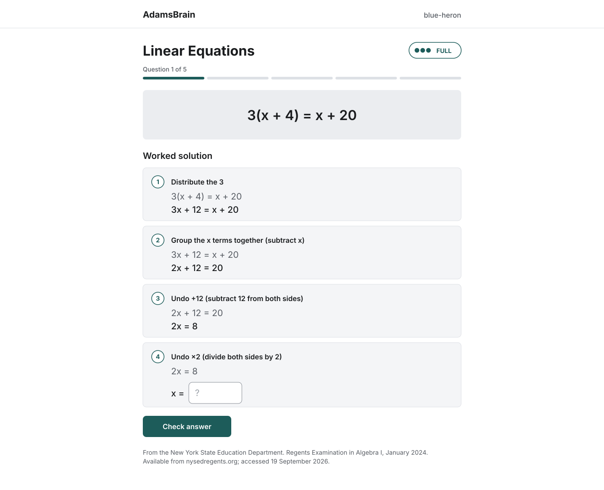

# AdamsBrain screens (M1)

Four screens, ten states. Drawn at Chromebook width (1366px). Colours and type: [design-tokens.md](design-tokens.md).
To edit, drag the SVG files into Figma (extract the files first if they came in a zip).

| Screen | State | File |
|---|---|---|
| Login | default | [01-login.svg](screens/01-login.svg) |
| Login | wrong username or password | [02-login-error.svg](screens/02-login-error.svg) |
| Set password | default (first login only) | [03-set-password.svg](screens/03-set-password.svg) |
| Set password | passwords don't match | [04-set-password-error.svg](screens/04-set-password-error.svg) |
| Practice | FULL scaffold | [05-practice-full.svg](screens/05-practice-full.svg) |
| Practice | HALF scaffold | [06-practice-half.svg](screens/06-practice-half.svg) |
| Practice | NONE scaffold | [07-practice-none.svg](screens/07-practice-none.svg) |
| Practice | correct answer | [08-feedback-correct.svg](screens/08-feedback-correct.svg) |
| Practice | wrong answer | [09-feedback-incorrect.svg](screens/09-feedback-incorrect.svg) |
| Session complete | default | [10-session-complete.svg](screens/10-session-complete.svg) |

## Rules the screens follow

- No sign-up page. Accounts come from the teacher. The login error does not say which field was wrong.
- HALF chips show no right or wrong until "Check answer".
- A wrong answer shows the correct working only. No retry and no guessing what the student did wrong.
- No points, streaks, badges or confetti.

## Preview

Previews on GitHub may show a fallback font because Inter is not embedded in the SVGs.
