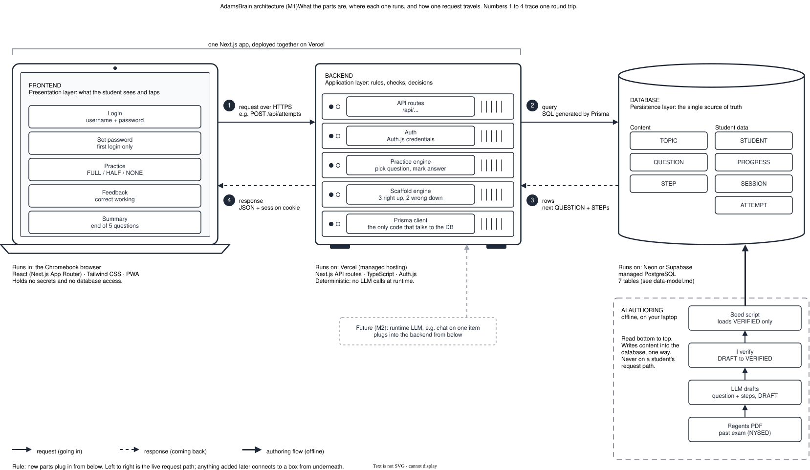

# AdamsBrain architecture (M1)

To edit: open `architecture.drawio.svg` in draw.io (or VS Code with a draw.io extension) and save. The same file stays an image GitHub can display.

## The layers

| Layer | Job | Tech | Runs on |
|---|---|---|---|
| Frontend | What the student sees and taps: login, set password, practice, feedback, summary | React (Next.js App Router), Tailwind CSS, PWA | Student's Chromebook browser |
| Backend | Rules and decisions: check login, pick the next question, mark answers, move scaffold levels | Next.js API routes, Auth.js, TypeScript, Prisma client | Vercel |
| Database | Single source of truth: the 7 tables in [data-model.md](data-model.md) | PostgreSQL | Neon or Supabase |
| AI authoring | Drafts questions and steps from Regents PDFs; Ahmed verifies them | LLM API, seed script | Ahmed's laptop, offline |

## One round trip (numbers in the diagram)

1. The browser sends a request over HTTPS, for example `POST /api/attempts` with the student's answer.
2. The backend checks the session, then queries Postgres through Prisma.
3. Postgres returns rows, for example the next QUESTION and its STEPs.
4. The backend sends JSON back to the browser, along with the session cookie.

## Rules this diagram encodes

- **Frontend and backend are one Next.js app**, deployed together on Vercel. They are separate layers but one deployment (ADR-001).
- **Only the backend talks to the database**, and only through Prisma. The browser never holds database credentials.
- **No LLM at runtime.** The AI authoring path is offline and one way: it writes VERIFIED content into the database and is never on a student's request path.
- **New parts plug in from below.** Left to right is the live request path. Anything added later (for example an M2 runtime LLM) connects to a box from underneath, so the main path never has to be redrawn.
