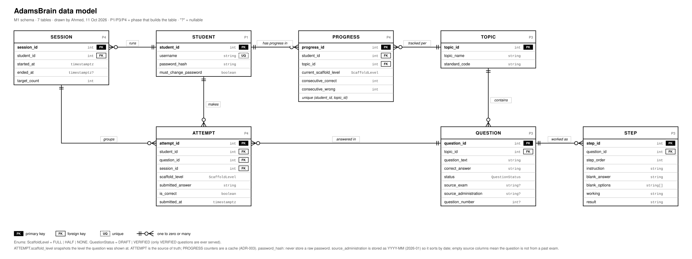

# AdamsBrain data model (ERD)

Seven tables, drawn by Ahmed on 11 Oct 2026. The picture above shows the relationships;
the tables below list every column. Once Phase 1
exists, `prisma/schema.prisma` is the source of truth and both of these follow it.

## How to read a line

Ask: **whose name is written on the paper?** The table that belongs to the other
is the child. The child is the "many" side, gets the crow's foot, and holds the
foreign key. A child has exactly one parent of each kind; ATTEMPT has three
parents, so it carries three foreign keys.

## Columns

**STUDENT**
| column | type | notes |
|---|---|---|
| student_id | int | PK |
| username | string | unique; assigned, never a real name |
| password_hash | string | never the raw password |
| must_change_password | boolean | true until first login |

**TOPIC**
| column | type | notes |
|---|---|---|
| topic_id | int | PK |
| topic_name | string | |
| standard_code | string | state standard the skill maps to |

**QUESTION**
| column | type | notes |
|---|---|---|
| question_id | int | PK |
| topic_id | int | FK to TOPIC |
| question_text | string | |
| correct_answer | string | |
| status | DRAFT \| VERIFIED | only VERIFIED is served |
| source_exam | string, nullable | e.g. Algebra I Regents |
| source_administration | string, nullable | YYYY-MM, e.g. 2026-01 |
| question_number | int, nullable | e.g. 23 |

**STEP**
| column | type | notes |
|---|---|---|
| step_id | int | PK |
| question_id | int | FK to QUESTION |
| step_order | int | 1, 2, 3 ... |
| instruction | string | sentence with one gap |
| blank_answer | string | word that fills the gap |
| blank_options | string[] | chips shown at HALF |
| working | string | equation before the step |
| result | string | equation after the step |

**PROGRESS** (unique on student_id + topic_id)
| column | type | notes |
|---|---|---|
| progress_id | int | PK |
| student_id | int | FK to STUDENT |
| topic_id | int | FK to TOPIC |
| current_scaffold_level | FULL \| HALF \| NONE | |
| consecutive_correct | int | 3 promotes |
| consecutive_wrong | int | 2 demotes |

**SESSION**
| column | type | notes |
|---|---|---|
| session_id | int | PK |
| student_id | int | FK to STUDENT |
| started_at | timestamptz | |
| ended_at | timestamptz, nullable | empty = left early |
| target_count | int | usually 5 |

**ATTEMPT**
| column | type | notes |
|---|---|---|
| attempt_id | int | PK |
| student_id | int | FK to STUDENT |
| question_id | int | FK to QUESTION |
| session_id | int | FK to SESSION |
| scaffold_level | FULL \| HALF \| NONE | level the question was shown at |
| submitted_answer | string | |
| is_correct | boolean | |
| submitted_at | timestamptz | |

## Every line

| Parent (two ticks) | Child (crow's foot) | Key in the child |
|---|---|---|
| STUDENT | SESSION | student_id |
| STUDENT | PROGRESS | student_id |
| STUDENT | ATTEMPT | student_id |
| TOPIC | PROGRESS | topic_id |
| TOPIC | QUESTION | topic_id |
| QUESTION | STEP | question_id |
| QUESTION | ATTEMPT | question_id |
| SESSION | ATTEMPT | session_id |

## Decisions recorded here

- **PROGRESS** (formerly MASTERY) is one row per student per topic: where that
  student is now. It is updated in place. History lives in ATTEMPT.
- **ATTEMPT** is the source of truth. PROGRESS counters are a cache of it
  (ADR-003). `ATTEMPT.scaffold_level` snapshots the level each question was shown
  at, because a correct answer at FULL and at NONE are different evidence.
- **QUESTION.status**: the LLM writes DRAFT rows; only the teacher's review sets
  VERIFIED, and only VERIFIED questions are served.
- **Source columns** give the NYSED credit line (PRD section 9).
  `source_administration` is stored as `YYYY-MM` so it sorts by date and shows as
  "January 2026". All three are empty for questions not taken from a past exam.
- **STEP** holds each worked line once. FULL, HALF and NONE are three ways of
  rendering the same rows, chosen from PROGRESS at request time.
- **SESSION.target_count** snapshots the session length (5) so old sessions stay
  correct if the length changes, and so a session with fewer attempts than its
  target shows the student left early.
- **No sign-up page.** The teacher creates accounts with a seed script and
  temporary passwords; `must_change_password` forces a new password on first
  login.
- **Not in M1:** SECTION (one class only; add in M2), `display_name` and `email`
  on STUDENT (add as nullable columns if the school approves).
